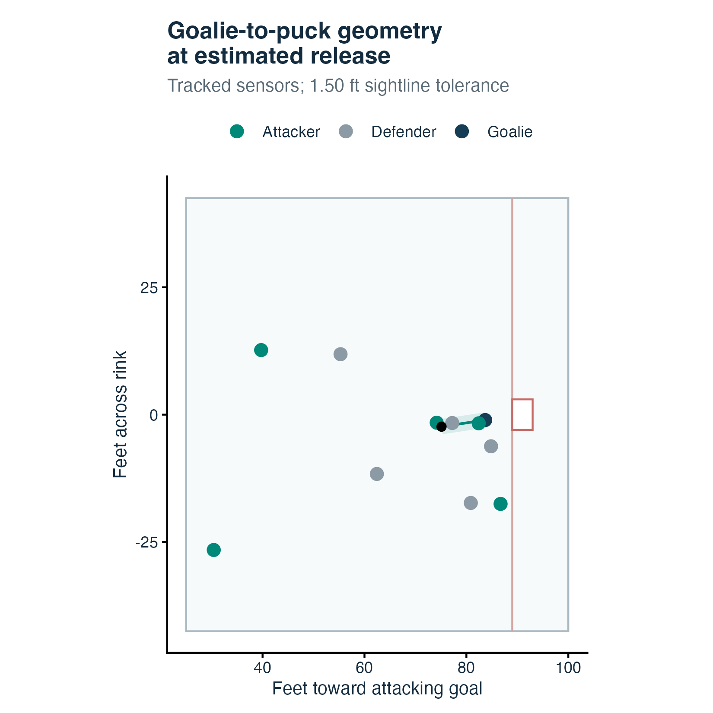
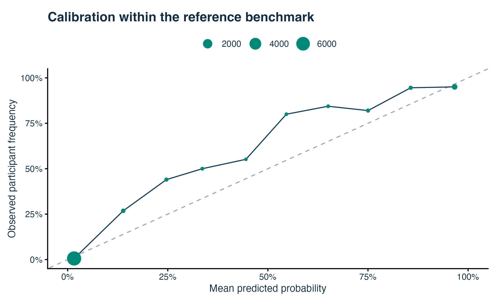
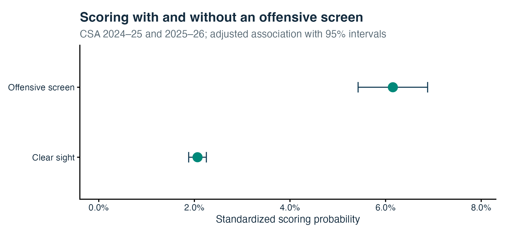

```{r}
# Read Public Results ----------------------------------------------------

# Load shared publication artifacts.
read_result <- function(name) {
  jsonlite::read_json(base::paste0('../docs/data/', name, '.json'), simplifyVector = TRUE)
}
rankings   <- read_result('rankings')
validation <- read_result('validation')
outcome    <- read_result('outcome')
model      <- read_result('model')
provenance <- read_result('provenance')
final      <- validation$metrics[['20252026']]

# Format numerical findings consistently.
fmt <- function(x, digits = 2) base::formatC(x, format = 'f', digits = digits, big.mark = ',')
count <- function(x) fmt(x, 0)
pct <- function(x) base::paste0(fmt(100 * x), '%')
interval <- function(x, scale = 1) {
  base::paste0(fmt(scale * x$estimate), ' (', fmt(scale * x$lower),
               ', ', fmt(scale * x$upper), ')')
}

# Aggregate completed-season player rankings.
leaders <- rankings$rows |>
  dplyr::filter(.data$season == 20252026L, .data$type == 2L) |>
  dplyr::group_by(.data$player) |>
  dplyr::summarise(conservative = base::sum(.data$conservative),
                   broader = base::sum(.data$broader), games = base::sum(.data$games),
                   seconds = base::sum(.data$seconds), .groups = 'drop') |>
  dplyr::left_join(rankings$players, by = base::c('player' = 'id')) |>
  dplyr::arrange(dplyr::desc(.data$conservative), dplyr::desc(.data$broader), .data$name)
```

# Introduction

The puck reaches the net, the goal light comes on, and the scoring record names a shooter and at most two assistants. A teammate stationed between the puck and goaltender may appear nowhere in that record. The contribution is familiar to anyone watching hockey: a goalie has less time to read a shot when another player occupies the line of sight. Measuring that contribution requires more care than counting bodies near the crease. The relevant player must be in the right place at the right moment, and a useful ranking must distinguish a plausible screen from incidental traffic.

Screen assists already have a history. @cait2019 manually identifies contributions on goals, including stationary and moving screens. Tracking-based work by @pitassi2025 studies traffic in a lane extending from the puck toward the goalposts, showing why traffic and shot location must be considered together. Their question also includes whether a shot reaches the net. @iaboni2025 develops a related visibility framework that combines tracking and video-derived player poses. These approaches motivate our emphasis on timing, geometry, and careful distinctions among shot populations.

We pursue a narrower, reproducible task: identify offensive teammates whose tracked positions resemble independently annotated screens on goals. Public NHL goal replays provide the trajectories; Clear Sight Analytics (CSA) supplies a private reference for detector development and evaluation. We then connect each estimated credit to its replay and aggregate counts using official player exposure. A separate CSA shot analysis examines screening's association with scoring. That analysis establishes substantive context for the statistic without converting a descriptive credit into a causal estimate of goals created.

# Data and study populations

## Public goals and player exposure

The snapshot includes completed regular-season and playoff games in 2023--24, 2024--25, and 2025--26, plus 2026--27 games dated through October 19, 2026. We exclude shootout events and use the development version of `nhlscraper` [@nhlscraper]. The public input snapshot and package commits are recorded in the repository. Official skater appearances and time on ice provide the exposure denominators, with the player's team assigned separately in every game.

The public replay feed contains planar puck and player coordinates, identities, and timestamps. The observed sampling interval is 0.10 s. Sequences generally span about 12--14 s, but their endpoints do not define shot release or goal time. We sort timestamps, retain the first observation at a duplicated timestamp, and follow player identifiers across tracking slots. Coordinates are in feet on a rink centered at the origin.

There are `r count(rankings$goals)` eligible goals. Stored replay availability in 2023--24 is 99.22% before tracking-quality exclusions, so we retain that season. Across the snapshot, `r count(rankings$evaluated)` goals have a usable shot interval and candidate teammates. @tbl-population separates these from empty nets and other unevaluable sequences. An unevaluable goal is not classified as an observed absence of screening.

```{r}
#| label: tbl-population
#| tbl-cap: 'Public goal population after shootout exclusion. The current season ends on October 19, 2026.'

# Summarize public replay eligibility.
population <- rankings$quality |>
  dplyr::mutate(group = dplyr::case_when(
    .data$status == 'evaluated' ~ 'Evaluated',
    .data$status == 'empty_net' ~ 'Empty net',
    TRUE ~ 'Unevaluable')) |>
  dplyr::group_by(.data$season, .data$group) |>
  dplyr::summarise(n = base::sum(.data$goals), .groups = 'drop') |>
  tidyr::pivot_wider(names_from = 'group', values_from = 'n', values_fill = 0) |>
  dplyr::mutate(Goals = .data$Evaluated + .data$`Empty net` + .data$Unevaluable,
                Season = base::paste0(.data$season %/% 10000, '--',
                                      base::substr(.data$season, 7, 8))) |>
  dplyr::select('Season', 'Goals', 'Evaluated', 'Empty net', 'Unevaluable')
knitr::kable(population, booktabs = TRUE, format.args = base::list(big.mark = ','))
```

## Independent reference annotations

We query CSA's historical reporting database read-only and retain private records in memory. Reference events must be game-reviewed, quality-control complete, classified as shots, and associated with an identifiable goalie. Game identity, scorer, teams, goalie, period, and clock must agree with the public goal. An imported event identifier is accepted only after these checks. When it is unavailable, we require a unique exact clock-and-scorer match. Participants are mapped through NHL identifiers and duplicate event--player--side memberships are removed.

Positive events require an explicit offensive-screen, mixed-screen, one-timer/screen, or screen/deflection classification and at least one named offensive teammate other than the scorer. Negative events require an explicit clear-sight or defensive-only classification with no offensive teammate recorded. We exclude screen-on-pass cases and screen-classified events lacking a named offensive teammate. Thus, an absent participant row alone never establishes a negative event.

Within a participant-bearing event, the recorded participant list is the player-attribution reference. We treat other candidate teammates as negatives and count a named participant missing from usable tracking as an unrecovered positive. This requires an assumption that participant lists are complete. The annotations also do not supply a fully explicit operational threshold for a flash screen or a frame-level start time. Consequently, reference disagreement can reflect either detector error or differences in coding scope.

@tbl-reference describes the matched and evaluable benchmark. The benchmark's screening prevalence is determined by these eligibility rules; it does not represent an unbiased sample of every NHL goal.

```{r}
#| label: tbl-reference
#| tbl-cap: 'CSA reference populations. Matched goals precede label and replay-quality restrictions.'

# Display aggregate reference counts without event labels.
reference <- validation$reference
reference$season_start <- base::paste0(reference$season_start, '--',
                                      base::substr(reference$season_start + 1, 3, 4))
knitr::kable(reference, col.names = base::c('Season', 'Matched goals', 'Benchmark goals',
                                           'Screen-positive goals'),
             booktabs = TRUE, format.args = base::list(big.mark = ','))
```

# Estimating a screen assist

## Release and arrival

We rotate each sequence so the defending goal is at $x=89$ ft. Candidate arrivals cross this plane toward the net with an interpolated lateral coordinate within 4.50 ft of its center. This modest tolerance accommodates tracking error near the 6 ft goalmouth. We search backward up to 2.00 s for a shot interval, requiring physically plausible puck speed and agreement with the official shot location.

For ordinary shots, a release candidate moves toward goal at at least 12 ft/s, lies within 22 ft of the recorded shot location and 12 ft of the scorer's sensor, and is followed by at least 2 ft of additional puck--scorer separation over up to 0.30 s. We choose the candidate minimizing location error divided by 10 ft plus scorer separation divided by 5 ft. These tolerances accommodate a stick release displaced from the shoulder and coarse official shot locations; they do not identify contact with the stick.

For tips and deflections, we trace the incoming flight backward through consecutive fast-moving samples and verify the credited scorer near the terminal deflection. This approximates the original release instead of treating the scorer's final touch as the entire shot. A rebound goal uses its scoring attempt and location. Earlier traffic contributes only if it also occupies the scoring attempt's analysis window.

We require at least 0.50 s of preceding tracking, reject gaps longer than 0.21 s in the critical interval, and reject missing puck or goalie positions. A second plausible arrival with a similar matching cost but a substantially different time makes the sequence ambiguous. The resulting release and arrival estimates describe a trajectory-based reconstruction; their accuracy is limited by 10 Hz sampling, planar coordinates, and the absence of puck-touch annotations.

## Finite sightline features

At time $t$, let $g_t$, $p_t$, and $s_{it}$ be the tracked goalie, puck, and candidate player's positions. With $v_t=p_t-g_t$, define

$$
u_{it}=\frac{(s_{it}-g_t)^\mathsf{T}v_t}{v_t^\mathsf{T}v_t},
\qquad
d_{it}=\left\|(s_{it}-g_t)-u_{it}v_t\right\|.
$$

We evaluate obstruction only when $0<u_{it}<1$ and the segment exceeds 2 ft. A player behind the goalie or beyond the puck therefore cannot qualify solely through proximity to the extended line.

We summarize the 0.50 s before release, a band from $-0.20$ to $+0.10$ s around release, and flight toward the goalie. Post-release windows stop at arrival and exclude puck positions more than 1 ft beyond the goalie's longitudinal position. Obstruction duration integrates the portion of each 0.10 s sampling interval within the relevant window. Reacquisition time is the interval since the most recent obstruction within the preceding 1.00 s, capped at 1.00 s when none is observed. Candidate players require at least three valid samples and 80% observed positions in the feature window.

The 16 predictors describe minimum and release-time separation, obstruction duration under primary and narrower/wider tolerances, longest continuous duration, flight obstruction, alignment strength before/near/after release, reacquisition time, goalie proximity, relative depth, crossing, shot distance, and flight time. For an effective radius $r$, alignment strength is

$$
A_{it}(r)=
\frac{\exp\{-d_{it}^2/(2r^2)\}}{1+\|s_{it}-g_t\|/20},
$$

with zero strength outside the finite segment. The geometric baseline multiplies peak near-release or flight alignment by a duration factor and an exponential penalty for time since the last pre-release obstruction. Specifically, if $D_i$ is obstruction duration and $R_i$ is reacquisition time in seconds,

$$
B_i=\max(A_{i,\mathrm{near}},A_{i,\mathrm{flight}})
\{0.25+\min(1,D_i/0.30)\}\exp(-R_i/0.40).
$$

This baseline provides an interpretable comparison to the statistical detector.

## Position and timing uncertainty

The sensor is near the player's right shoulder, not at the center of a body model; the goalie sensor is not an eye position [@radke2021]. Body orientation cannot be recovered from movement direction. We also lack puck height, gaze, stance, and the extent to which limbs or equipment obscure vision.

Our primary effective tolerance is 1.50 ft. Bounded alternatives of 1.00 and 2.00 ft examine sensitivity to body extent and sensor displacement without substituting velocity for orientation. We also shift estimated release by $-0.10$ and $+0.10$ s. These scenarios preserve the selected model and thresholds. They quantify dependence on plausible geometric choices, but they are not calibrated distributions of anatomical error and do not span every possible goalie posture.

```{r}
#| label: fig-geometry
#| fig-cap: 'An actual replay at estimated release. Tracked sensor positions define the finite goalie-to-puck segment; the band illustrates effective geometric tolerance.'
#| fig-width: 4.8
#| out-width: '65%'

# Include public replay illustration.

```

## Model selection and attribution

We develop on 2023--24, select the model and thresholds on 2024--25, and reserve 2025--26 for final evaluation. Games remain together because the split is by season. The ridge logistic model uses standardized public features and an unpenalized intercept through `tidymodels` and `glmnet`. We compare the geometric baseline with five requested ridge penalties, $10^{-4}$, $10^{-3}$, $10^{-2}$, $10^{-1}$, and $1$, along the engine's regularization path. Requests below the fitted path's minimum use its terminal coefficients. Model selection uses player-level average precision with tied-score groups, preferring the baseline if average precision ties.

For the selected detector, the conservative threshold maximizes

$$
F_{0.5}=\frac{1.25\,PR}{0.25P+R},
$$

where $P$ and $R$ denote precision and recall. The broader threshold maximizes $F_1=2PR/(P+R)$ subject to being no higher than the conservative threshold. The thresholds are `r fmt(model$thresholds$conservative, 4)` and `r fmt(model$thresholds$broader, 4)`, respectively. We freeze coefficients and thresholds before final-season evaluation.

Each qualifying offensive teammate receives one credit per goal, excluding the credited scorer. Multiple teammates can receive credit, including official assist recipients. Conservative credits form a subset of broader credits by construction. A goal-level prediction is positive when at least one teammate qualifies.

We report precision, recall, average precision, and, for the classifier, calibration. Threshold-specific 95% intervals use a game-clustered sandwich calculation for each ratio. For example, with precision $\hat P=\sum_g T_g/\sum_g N_g$, the estimated variance is

$$
\widehat{\operatorname{Var}}(\hat P)=
\frac{G}{G-1}
\frac{\sum_g(T_g-\hat P N_g)^2}{(\sum_g N_g)^2}.
$$

We truncate Wald interval endpoints to $[0,1]$. These intervals describe benchmark sampling variation and do not include annotation uncertainty or uncertainty from model selection.

We supplement numerical evaluation with a targeted tracking-frame review of 12 development-season player--goal cases across 11 goals, plus an additional unresolved trajectory. The cases span strong alignment, participant disagreements, multiple potential screeners, tips, a rapid follow-up scoring attempt, and a threshold-adjacent crossing. We compare frames before, at, and after estimated release. This review characterizes failure mechanisms; it does not supply a new accuracy estimate or an independent video-based judgment of the goalie's vision.

## Exposure and rankings

For player $i$ under a common set of season, competition, team, and cutoff filters, we compute

$$
\operatorname{SA/game}_i=\frac{C_i}{G_i},
\qquad
\operatorname{SA/60}_i=\frac{3600C_i}{T_i},
$$

where $C_i$ is estimated credits, $G_i$ is official appearances, and $T_i$ is ice time in seconds. Traded players' records follow their team in each game. Players with no detected credits remain in the table. Rate rankings initially require five games or 60 minutes, with adjustable minimums; count rankings impose no minimum.

The denominator includes all official exposure, while the numerator includes detected credits in evaluable goal replays. This choice makes the rate interpretable as observed credits per actual exposure. It also means missing or unresolved tracking can depress rates, and totals are not corrected estimates of every screen assist that occurred.

# Screening and scoring

The relevance analysis uses a separate CSA population from 2024--25 and 2025--26, when release-type information is available. CSA describes its central coverage as shot sequences resulting in shots on goal [@csa]; database records must not be assumed to cover all blocked and missed attempts.

We compare reviewed, quality-complete offensive-screen and clear-sight shots with a goalie present. Screen-on-pass cases, posts, and deflection releases are excluded. Mixed screens, defensive screens, one-timer/screen categories, and rebound categories remain outside this primary contrast. Each included season--strength--precise-location--release stratum contains both screened and clear-sight observations.

The prespecified mixed-effects logistic model is

$$
\operatorname{logit}\{\Pr(Y_j=1)\}
=\alpha+\beta S_j+x_j^\mathsf{T}\gamma
+b_{\mathrm{shooter}(j)}+b_{\mathrm{goalie}(j)}+b_{\mathrm{game}(j)}.
$$

Here $S_j$ indicates an offensive screen; $x_j$ contains season, regular-season/playoff status, strength, precise shot zone, release type, broad play context, first and second preceding-pass zones, and attacking and defending teams. Shooter, goalie, and game intercepts follow independent mean-zero normal distributions. Unknown pass/context levels are retained explicitly. No CSA scoring probability enters the model.

We fit the model through `tidymodels` with the `multilevelmod`/`lme4` engine, using penalized iteratively reweighted least squares (`nAGQ = 0`). We standardize screened and clear-sight predictions over the covariate distribution of screened shots in common support, integrating the fitted random-intercept distributions with 41 deterministic normal-quantile nodes. Fixed-effect Wald intervals describe the adjusted odds ratio; delta-method intervals describe standardized rates and their difference. Variance components remain fixed in these interval calculations.

# Results

## Independent attribution performance

The ridge detector has tuning-season average precision `r fmt(base::max(validation$comparison$average_precision), 3)`, compared with `r fmt(validation$comparison$average_precision[1], 3)` for the geometric baseline. On the reserved season, player-level average precision is `r fmt(final$average_precision, 3)` and goal-level average precision is `r fmt(final$event_average_precision, 3)`.

The final benchmark includes `r count(final$conservative$event$n)` goals and `r count(final$conservative$player$n)` candidate-player units, with `r count(final$conservative$player$positives)` annotated offensive teammate contributions. Conservative attribution recovers `r count(final$conservative$player$true_positive)` of those contributions and disagrees with the reference on `r count(final$conservative$player$false_positive)` predicted participants. Broadening the threshold recovers `r count(final$broader$player$true_positive)` contributions while increasing those disagreements to `r count(final$broader$player$false_positive)`.

```{r}
#| label: tbl-performance
#| tbl-cap: 'Reserved 2025--26 performance, with game-clustered 95% intervals.'

# Format attribution and event performance.
performance <- base::list()
for (definition in base::c('conservative', 'broader')) {
  for (level in base::c('player', 'event')) {
    value <- final[[definition]][[level]]
    format_metric <- function(metric) {
      base::paste0(fmt(100 * value[[metric]]), ' (',
                   fmt(100 * value[[base::paste0(metric, '_low')]]), ', ',
                   fmt(100 * value[[base::paste0(metric, '_high')]]), ')')
    }
    performance[[base::length(performance) + 1L]] <- base::data.frame(
      Definition = if (definition == 'conservative') 'Conservative' else 'Broader',
      Task = if (level == 'player') 'Player' else 'Goal',
      Precision = format_metric('precision'), Recall = format_metric('recall'))
  }
}
knitr::kable(dplyr::bind_rows(performance), booktabs = TRUE,
             col.names = base::c('Definition', 'Task', 'Precision (%)', 'Recall (%)'))
```

Goal-level detection performs somewhat better than participant attribution (@tbl-performance). That distinction matters for a leaderboard: correctly detecting traffic on a goal does not guarantee that the credited player is correct.

Calibration also warrants care. The held-out Brier score is `r fmt(final$calibration$brier, 4)`, but intermediate-score bins have higher observed participant frequencies than their mean predictions. The strong concentration of nonparticipants in the lowest bin contributes to the low overall Brier score. We therefore use the score for empirically selected thresholds and do not present it as a universally calibrated probability of a meaningful screen.

```{r}
#| label: fig-calibration
#| fig-cap: 'Calibration on the reserved reference set. Point size reflects bin count. Intermediate-score bins show underprediction, and calibration outside this selected benchmark is unknown.'
#| out-width: '85%'

# Include held-out calibration figure.

```

## Player rankings and sensitivity

Across all included seasons and competitions, the detector assigns `r count(base::sum(rankings$rows$conservative))` conservative and `r count(base::sum(rankings$rows$broader))` broader credits. In the completed 2025--26 regular season, `r leaders$name[1]` leads with `r leaders$conservative[1]` conservative credits, followed by `r leaders$name[2]` with `r leaders$conservative[2]`. @tbl-leaders supplies both totals and exposure-adjusted rates for the leading players.

```{r}
#| label: tbl-leaders
#| tbl-cap: 'Leading conservative screen-assist totals, 2025--26 regular season. Rates use conservative credits.'
#| tbl-pos: H

# Display leading players with common exposure denominators.
leader_table <- leaders |>
  dplyr::slice_head(n = 10L) |>
  dplyr::transmute(Player = .data$name, Conservative = .data$conservative,
                   Broader = .data$broader, GP = .data$games,
                   `SA/game` = fmt(.data$conservative / .data$games),
                   `SA/60` = fmt(3600 * .data$conservative / .data$seconds))
knitr::kable(leader_table, booktabs = TRUE, longtable = FALSE,
             format = if (knitr::is_latex_output()) 'latex' else 'pipe')
```

The website opens on the current season, where short exposure makes ties and large rate changes common. It keeps both definitions visible and allows the reader to inspect each credited goal. A zero in either column means no contribution is detected under that definition and filter; it does not establish that the player never screens.

The targeted frame review makes two limitations concrete. Players can move across the segment within a few samples, so a convincing alignment at release can disappear immediately afterward. Conversely, an annotated participant can sit outside the narrow sensor-defined segment while body position remains unobserved. In the unresolved example, the tracked puck crosses the goal plane 6.38 ft from its center, outside even our goalmouth tolerance. We retain that event as unevaluable instead of forcing a shot interval from an inconsistent trajectory.

Sensitivity is material (@tbl-sensitivity). Both effective tolerance and release timing change the number of qualifying contributions. These differences show why marginal credits need inspection and why the two main attribution definitions should not be mistaken for an exhaustive uncertainty range.

```{r}
#| label: tbl-sensitivity
#| tbl-cap: '2025--26 regular season and playoffs combined: fixed-detector sensitivity to geometry and release timing.'

# Present bounded sensitivity scenarios.
sensitivity <- validation$sensitivity |>
  dplyr::filter(.data$season == 20252026L) |>
  dplyr::mutate(Scenario = dplyr::recode(.data$scenario,
    Primary = 'Primary: 1.50 ft',
    `_r1` = 'Tolerance: 1.00 ft', `_r2` = 'Tolerance: 2.00 ft',
    `_t1` = 'Release: 0.10 s earlier', `_t2` = 'Release: 0.10 s later')) |>
  dplyr::select('Scenario', 'conservative', 'broader')
knitr::kable(sensitivity, col.names = base::c('Scenario', 'Conservative', 'Broader'),
             booktabs = TRUE)
```

## Adjusted scoring association

The common-support population contains `r count(outcome$screened_shots)` screened shots and `r count(outcome$clear_shots)` clear-sight shots across `r count(outcome$games)` games. It retains `r pct(outcome$screened_retention)` of otherwise eligible screened shots. Observed screened scoring rates are `r pct(outcome$observed$rate[outcome$observed$screen == 1][1])` and `r pct(outcome$observed$rate[outcome$observed$screen == 1][2])` in the two seasons; the clear-sight rates are `r pct(outcome$observed$rate[outcome$observed$screen == 0][1])` and `r pct(outcome$observed$rate[outcome$observed$screen == 0][2])`.

After adjustment and standardization to screened-shot covariates, the screened scoring rate is `r interval(outcome$adjusted$screened_rate, 100)` percent and the clear-sight rate is `r interval(outcome$adjusted$clear_rate, 100)` percent, with 95% intervals in parentheses. Their difference is `r interval(outcome$adjusted$risk_difference, 100)` percentage points. The adjusted odds ratio is `r interval(outcome$adjusted$odds_ratio)`.

```{r}
#| label: fig-scoring
#| fig-cap: 'Standardized scoring rates with model-based 95% intervals. Both predictions use screened-shot covariates within common support.'
#| out-width: '95%'

# Include adjusted scoring comparison.

```

The optimizer converges, but the goalie random-intercept variance lies at zero. Shooter and game variances are approximately 0.0052 and 0.0049 on the log-odds scale. We retain this boundary fit and report its interval assumptions. The observed contrast is consistent with a screening association within the selected CSA population, although unmeasured shot characteristics, detailed pass timing, player selection, and classification practices could still contribute.

# Discussion

Public replay tracking supports a useful first layer of screen attribution. The reserved-season results show that a relatively simple detector can identify many independently named participants with high precision under a conservative threshold. A broader threshold recovers more annotated contributions, providing an explicit tradeoff instead of concealing borderline plays in a single count.

The rankings remain descriptive. They condition on a goal being scored, so a player whose screens help produce saves, misses, or blocked attempts cannot receive credit here. Team shooting volume, offensive role, special-teams deployment, and teammate finishing influence opportunities. Official ice-time denominators improve exposure comparability but do not remove those differences.

Several measurement limits remain substantial. The goalie-to-puck segment is a two-dimensional approximation of a three-dimensional visual process. The right-shoulder sensor and unknown eye position complicate near-boundary cases, while brief crossings can occur between samples. Release inference is especially difficult when a deflection, rebound, or goalie contact changes the puck's trajectory. Unevaluable cases are retained as such, and their distribution need not be random across teams or types of play.

The independent reference also narrows interpretation. Explicit categories and participant identities make evaluation possible, but their selection changes prevalence and leaves ambiguous plays outside the benchmark. A named participant is not an infallible label; an unlisted teammate may still obstruct vision. The held-out estimates measure agreement with this defined reference, not perfect knowledge of a goalie's perception.

Finally, the scoring study and detector address different populations. CSA non-goals support an adjusted association analysis, while public goal replays support attributable credits. Neither the adjusted odds ratio nor the standardized difference can be multiplied by a player's screen-assist total to estimate causal goals added. Establishing that quantity would require broader tracking, stronger adjustment for shot selection, and a defensible counterfactual design.

The practical value of this snapshot is that readers can move from a ranking to a play. A count is accompanied by a definition, measured performance, visible geometry, and alternative assumptions. That combination makes screen assists a concrete subject for discussion and subsequent validation while preserving the uncertainty that the available measurements impose.

# Data and code availability

The [public website](https://RentoSaijo.github.io/NHL_ScreenAssists/) provides rankings, replay exploration, methodology, and this paper. The [repository](https://github.com/RentoSaijo/NHL_ScreenAssists) contains original R code, a documented pipeline, editable Quarto source, explicit detector coefficients, NHL-derived goal--player credits, player-game exposure, short replay segments, and aggregate research results. Input provenance records the `nhlscraper` revision and immutable public database snapshot.

CSA records and event-level labels are not distributed. Fitted private model objects are not exported. Public artifacts reproduce the published ranking arithmetic, figures, and report; authorized CSA access is required to re-estimate the reference-dependent models. This is a fixed research snapshot with no scheduled refresh.



# References {.unnumbered}

::: {#refs}
:::
